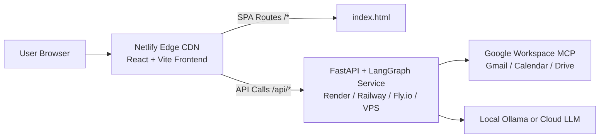

# 🚀 Netlify Deployment Guide

This guide explains how to deploy the **Personal AI Agent Studio** with Netlify.

---

## Architecture Overview



1. **Frontend**: Hosted on **Netlify** with global edge CDN, continuous deployment via Git, and automatic SSL.
2. **Backend**: Hosted on a service supporting Python 3.10+ (such as **Render**, **Railway**, **Fly.io**, **Google Cloud Run**, or a VPS).
3. **Connectivity**: Netlify can either:
   - **Directly communicate** with the backend URL set via `VITE_API_BASE_URL` environment variable.
   - **Reverse-proxy** `/api/*` to the backend seamlessly using Netlify redirect rules, avoiding CORS entirely.

---

## Step 1: Deploy Frontend to Netlify

### Option A: Using the Netlify Web UI (Recommended)

1. Push your repository to **GitHub** (or GitLab / Bitbucket).
2. Go to [app.netlify.com](https://app.netlify.com/) and click **"Add new site"** ➔ **"Import an existing project"**.
3. Select your GitHub repository.
4. Netlify will automatically detect `netlify.toml` from the repository root:
   - **Base directory**: `frontend`
   - **Build command**: `npm run build`
   - **Publish directory**: `frontend/dist`
5. Click **"Deploy site"**.

### Option B: Using Netlify CLI

From the project root:
```bash
# Install Netlify CLI if needed
npm install -g netlify-cli

# Login and deploy
netlify login
netlify init
netlify deploy --prod
```

---

## Step 2: Deploy Backend & Agents

Since Netlify is a Jamstack platform designed for static sites and serverless lambdas, the long-lived Python multi-agent backend (LangGraph + Ollama/OpenAI + Google MCP) runs best in a container or Python runtime.

### Deploying to Render (Free / Starter Tier)
1. In [Render Dashboard](https://dashboard.render.com), click **New +** ➔ **Web Service**.
2. Connect your GitHub repository.
3. Configure settings:
   - **Runtime**: `Python 3` (or `Docker` using the included `Dockerfile`)
   - **Build Command**: `pip install -r requirements.txt`
   - **Start Command**: `uvicorn backend.app.main:app --host 0.0.0.0 --port $PORT`
4. Set Environment Variables:
   - `LLM_PROVIDER`: `groq` (Enables 24/7 cloud AI inference without needing your laptop or Ollama running!)
   - `GROQ_API_KEY`: Your Groq API key from https://console.groq.com/keys
   - `GROQ_MODEL`: `llama-3.3-70b-versatile` (or `llama-3.1-8b-instant`)
   - `FRONTEND_URL`: `https://your-site.netlify.app` (your Netlify production URL)
   - `OPENWEATHER_API_KEY`: *(Optional)* Your OpenWeather API key
   - `GOOGLE_WORKSPACE_CREDENTIALS`: *(Optional)* Content of `credentials.json`
5. Click **Create Web Service**. Note your Render URL (e.g. `https://my-agent-backend.onrender.com`).

---

## Step 3: Connect Netlify Frontend to Backend

Choose either of the two connection approaches:

### Approach 1: Environment Variable (Quickest)
1. In your **Netlify Dashboard**, go to **Site configuration** ➔ **Environment variables**.
2. Add a new variable:
   - **Key**: `VITE_API_BASE_URL`
   - **Value**: `https://my-agent-backend.onrender.com` (your backend URL without trailing slash)
3. Trigger a redeploy: **Deploys** ➔ **Trigger deploy** ➔ **Deploy site**.

### Approach 2: Netlify Reverse-Proxy Rewrite (No CORS)
In `netlify.toml`, uncomment and customize the redirect rule:
```toml
[[redirects]]
  from = "/api/*"
  to = "https://my-agent-backend.onrender.com/api/:splat"
  status = 200
  force = true
```
Push this change to GitHub. Netlify will automatically forward all `/api` traffic directly to your backend service!

---

## Step 4: Configure Google OAuth for Production

When using the in-app **"Sign in with Google"** button on Netlify:
1. Open the [Google Cloud Console](https://console.cloud.google.com/apis/credentials).
2. Select your OAuth 2.0 Client ID.
3. Under **Authorized redirect URIs**, add:
   - Your backend callback: `https://my-agent-backend.onrender.com/api/google/auth/callback`
   - If using Netlify reverse proxy: `https://your-site.netlify.app/api/google/auth/callback`
4. Under **Authorized JavaScript origins**, add:
   - `https://your-site.netlify.app`
5. Save changes. Users can now authenticate directly via the web UI!

---

## Summary of Configured Files

| File | Purpose |
|---|---|
| [`agent/agents/groq_llm.py`](./agent/agents/groq_llm.py) | Dedicated Groq Cloud LLM provider module for 24/7 serverless inference |
| [`.env.prod`](./.env.prod) | Production environment configuration with Groq credentials (git-ignored) |
| [`.env.example`](./.env.example) | Root environment configuration template with placeholders |
| [`netlify.toml`](./netlify.toml) | Root Netlify configuration (base, build command, publish dir, SPA fallback, optional proxy) |
| [`frontend/public/_redirects`](./frontend/public/_redirects) | Fallback SPA routing rule (`/* /index.html 200`) bundled into `frontend/dist/` |
| [`frontend/src/config/api.js`](./frontend/src/config/api.js) | Centralized API resolver supporting `VITE_API_BASE_URL`, local dev, and Netlify proxy |
| [`frontend/.env.example`](./frontend/.env.example) | Frontend environment template for Netlify variables |
| [`backend/app/routes/google.py`](./backend/app/routes/google.py) | Dynamic OAuth redirect supporting `FRONTEND_URL` environment variable |
| [`Dockerfile`](./Dockerfile) | Container definition for deploying backend alongside Netlify |
| [`Procfile`](./Procfile) | Standard PaaS process definition for Render / Railway |
